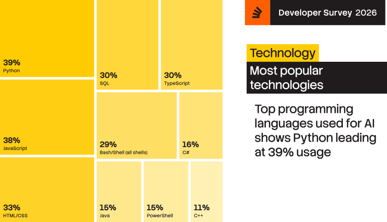

```{python}
#| echo: false
from IPython import get_ipython

ip = get_ipython()
if ip is not None:
    ip.InteractiveTB.mode = 'Minimal'

# AGH colours + colour-blind-safe linestyles + font sizes
import matplotlib
from cycler import cycler

%config InlineBackend.figure_formats = ['svg']
matplotlib.rcParams.update(
    {
        "lines.linewidth": 1.5,
        "lines.markersize": 5,
        "axes.grid": True,
        "font.size": 13,
        "axes.labelsize": 13,
        "axes.titlesize": 15,
        "legend.fontsize": 13,
        "xtick.labelsize": 13,
        "ytick.labelsize": 13,
        "figure.figsize": (10, 2.1),
        "legend.handlelength": 1.0,
        "figure.constrained_layout.use": True,
    }
)

```


## `Python` and modeling? {.AZ}

:::: {.columns}
::: {.column width="30%"}
The core of the language does not support:

- ordinary int 
- arrays
- JIT compilation
- multi-threading
- GPUs
- numerical algorithms


:::

::: {.column .fragment width="70%"}


:::
::::

But `Python` is designed as a **glue language**!

Above features are handled by packages: **NumPy**, **SciPy**, **Numba/JAX**

##  an experiment: paper on how to code  {.AZ}

::: {.notes}
section titles, iframe widths, logos
:::

{fig-align="center"}

## scope of the paper and of this talk {.AZ}

:::: {.columns}
::: {.column width=10%}
:::

::: {.column width="65%"}

<span style="color:#287fcc">Introduction</span>

1. aerosol size spectrum sampling     
2. <quote>unit-aware coding and plotting</quote>  
3. parcel model governing equations     
4. JIT compilation using Numba     
5. parcel ODE system definition     
6. <quote>test-time dimensional analysis using Pint</quote>
7. initial condition at equilibrium     
8. ODE integration and result analysis     
9. Super-Droplet Method algorithm    
10. SDM against analytic solution

::: {.fragment}
Summary
:::
::: {.fragment}
<quote>Code availability</quote>
::: 
:::

::: {.column width="25%"}


{width="100%"}

{width="100%"}

:::

::::


# unit-aware coding and plotting
## a useful physical example: ideal gas {.AZ}
<br>

:::: {.columns}
::: {.column width="15%"}
:::
::: {.column width="30%"}

<span style="font-size:500%">🎈</span>

<span style="font-size:300%">🎈</span>

<span style="font-size:200%">🎈</span>

<span style="font-size:100%">🎈</span>

<span style="font-size:50%">🎈</span>
:::

::: {.column width="55%"}

equation of state linking

>  $\rho$: density
> 
>  $p$: pressure
> 
>  $T$: temperature

$$\rho = (p M) / (T R)$$

where

> $M$: molar mass
> 
> $R$: universal gas constant

:::

::::

## Issue: units in code (example: ideal gas density) {.AZ}

$$\rho = (p M) / (T R)$$

. . .

<div class="strike-code">

```{python}
#| code-line-numbers: "1|1-2|1-8|"

import numpy, scipy, matplotlib.pyplot as plt
import mendeleev

p = 1000                                     # pressure [mbar]
T = numpy.linspace(250, 300)                 # temperature [K]
R = scipy.constants.R                        # gas constant [J/K/mol]
M = (0.78 * 2 * mendeleev.N.atomic_weight +  # molar mass [g/mol]
     0.22 * 2 * mendeleev.O.atomic_weight)

fig, axs = plt.figure(), plt.gca()
axs.plot(T, (p * M) / (R * T))
axs.set(ylabel="density", xlabel="temperature")
```
<div class="fragment strike-code"></div>
</div>
. . .


“_<quote>The proper use of comments is to compensate for our failure to express ourself in code ... 
Comments are always failures.</quote>_” (Robert C. Martin [_Clean Code_, 2009](https://books.google.pl/books/about/Clean_Code.html?id=EpeDEQAAQBAJ&redir_esc=y))


## Issue: units in comments not in code {.AZ} 

The interpreter is not parsing the comments!

We always use units on paper, use it in code as well.

```{python}
fig
```

- What is the unit of the plotted data?
- Reading the code, one needs to go to the definition each time.
- No way of enforcing changes in usage upon change of definition.
- After changing the value --- did you change the comment? 
- We all know the answer...


## physical units in code with `Pint` {.AZ}

<br> <br>

:::: {.columns}

::: {.column width="50%"}

<iframe src="pages/MetPy_NSF_Unidata.html" width="100%" height="650 pt"></iframe>

:::
::: {.column width="50%"}

<iframe src="https://pint.readthedocs.io/en/stable/getting/overview.html" width="100%" height="650 pt"></iframe>

:::
::::


## physical units with Pint (example: ideal gas density) {.AZ}

$$\rho = (p M) / (T R)$$

```{python}
#| code-line-numbers: "1-3|1-5|1-6|1-7|1-9|-"

import pint
SI = pint.UnitRegistry()
SI.setup_matplotlib()

pressure = 1000 * SI.mbar
temperatures = numpy.linspace(250, 300) * SI.K
gas_const = scipy.constants.R * SI.J / SI.K / SI.mol
molar_mass = (0.78 * 2 * mendeleev.N.atomic_weight +
              0.22 * 2 * mendeleev.O.atomic_weight) * SI.g / SI.mol

plt.plot(temperatures, (pressure * molar_mass) / (gas_const * temperatures))
```

- changed names of variables
- axis labels automatic


## 
### Can we ...

::: {.fragment}

- ... change units on plot?
:::

::: {.fragment}
```{python}
fig, axs = plt.figure(), plt.gca()
axs.xaxis.set_units(SI.degC)
axs.yaxis.set_units(SI.kg / SI.m**3)
axs.plot(temperatures, (pressure * molar_mass) / (gas_const * temperatures))
```
:::

::: {.fragment}
- ... change axes labels and still use units?
:::

::: {.fragment}

```{python}
fig, axs = plt.figure(), plt.gca()
axs.plot(temperatures, (pressure * molar_mass) / (gas_const * temperatures))
axs.set_xlabel(f"temperature [{axs.xaxis.units:~P}]")
axs.set_ylabel(f"density [{axs.yaxis.units:~P}]");
```
:::

::: {.notes}
to_base_units
pretty formatting
:::

## dimensional analysis using Pint {.AZ}

. . .

### Can we ...

::: {.fragment}

- ... change the units to the wrong ones?
:::

::: {.fragment}

```{python}
#| error: true
plt.gca().yaxis.set_units(SI.J)
plt.plot(pressure)
```
:::


::: {.fragment}

- ... put different quantities on same axis?
:::

::: {.fragment}

```{python}
#| error: true
try:
    plt.plot(temperatures)
    plt.plot(temperatures ** 2)
except Exception as e:
    plt.close()
    print(e.__cause__)
```
:::

## {.AZ}
### Can we ...

::: {.fragment}

- ... add Kelvins to Pascals?
:::


::: {.fragment}

```{python}
#| error: true

temperatures + pressure
```

:::

<br>

::: {.fragment}

- Tools for unit testing:

```{python}
((pressure * molar_mass) / (gas_const * temperatures)).check("[density]")
```

:::

## {.AZ}

### Pint: key takeaways

- ⚖️ performs dimensional analysis (unit testing!)
- ⚙️ automates plot axis labelling (and consistency checks)
- 💱 handles SI prefixes and unit conversions
- 🩺 helps in debugging (`print(x)` prints a value with unit)


::: {.fragment}
### Pint: key limitations
:::

::: {.fragment .strike}

- ⏱️ incurs performance overhead
:::
::: {.fragment .strike}

- 🔗 no out-of-the-box interoperability with SciPy/Numba
:::


## Issue: units with `SciPy` and `Numba` {.SA}

Problem with using units with `SciPy`/ `NumPy` packages:
```{python}
#| error: true
#| code-line-numbers: "1|1-3|-"

from scipy.optimize import root_scalar

f = lambda T, a, b: a / T + b

root_scalar(
    f=f,
    x0=1 * SI.K,
    args=(2 * SI.K**2, -3 * SI.K)
)
```


::: {.fragment}

<br>

Problem with using just-in-time compilation (`Numba`)
```{python}
#| code-line-numbers: "1|1-5|"
import numba

@numba.jit
def f(a, b, T):
  return a / T + b

print(f"{f(2, -3, 270):.3g}")
```
:::


::: {.fragment}
```{python}
#| error: true

f(2 * SI.K**2, -3 * SI.K, 270 * SI.K)
```

::: 

## How to use units with `scipy` and `numba`? {.SA}

`see Section 4. in our paper!`


TODO: Concept

## no excuse for coding without units, let's&nbsp;teach&nbsp;it! {.SA}

:::: {.columns style="font-size: 1em;"}

::: {.column width="33%"}
"hacking aerosol-cloud μ-physics modeling concepts in Python" 

**University of Washington**, Jan 2026, Seattle (Erasmus+ for teachers)


::: 

::: {.column width="33%"}
FOSDEM 2026

**Université libre de Bruxelles**, Feb 2026


::: 

::: {.column width="33%"}
"Gluing SciPy, Numba, and Pint to Bridge High Performance with Maintainability" 

EuroScipy 2026 (Jul, **Wydział Informatyki AGH**)


::: 

+ **AGH courses**: PP, PI, MUP, MPS, RSE, ...

::::

## looking for a venue and tool to publish it  {.AZ}

:::: {.columns}
::: {.column width="20%"}

{width="60%"}


:::

::: {.column width="80%"}

+ idea: 
  + use cloud-microphysics modeling as an example 
  + code-in-paper 
  + paper serving as ready-to-use workshop materials 
  + all figures reproducible by editors, reviewers, readers
+ venue: 
  + EGU Geoscientific Model Development: review and perspective paper
  + reproducibility is required by GMD
+ tool: 
  + everything in a single `Jupyter notebook` 
  + `Quarto` single click generation of the paper pdf!

:::
::::
## For reproducible science use `Quarto.org` {.AZ}

<iframe src="https://quarto.org" width="100%" height="75%"></iframe>

$\rightarrow$ Get started

::: {.notes}
... like the paper and this presentation (including code execution)
TODO width of iframes!
:::

## For reproducible science use `Quarto` {.AZ}
### `quarto render paper.ipynb --execute --to copernicus-pdf`
<iframe
  src="paper.pdf#page=30&toolbar=0&navpanes=0"
  style="width: 100%; height: 80vh; border: none;"
  loading="lazy">
</iframe>

## For reproducible science use `Quarto` {.AZ}

- useful for working on 
  - articles, reports, theses, books (`pdf`, `epub`, ...)
  - presentations, teaching materials (`revealjs`, `beamer`, ...)
  - web pages, data access and quick look dashboards (`html`, ...)

. . .

- supports 
  - BibTeX 
  - $\LaTeX$ syntax
  - vector graphics

. . . 

This presentation is in `Quarto`, including code execution!

## Journal templates from major publishers {.AZ}

<iframe src="pages/Quarto Journals.html" width="100%" height="75%"></iframe>


# Quarto: Apt for BEng/MSc/PhD theses

## Other universities {.SA}

## Habemus Python `https://habemus-python.github.io` {.SA}

:::: {.columns}

::: {.column width="40%"}

:::
::: {.column width="60%"}

:::

::::

## Quarto Actions {.SA}

TODO

## Summary and outlook


- Pint: no excuse to write code without units!
- Quarto: please support your students
- paper (can be run on Colab):
  DOI: `10.5194/egusphere-2026-3906`


. . .

<br>

::: {style="text-align: center;"}

**Thank you for your attention!**

Acknowledgements: Kamil Kania & the paper's co-authors

:::


::: {.notes}

+ encourage everyone to support their students in using Pint, Quarto, Habemus Python
+ AGH Summer/Winter school/workshop on cloud microphysics modeling using the GMD paper?
+ acknowledgements: Kamil, co-authors, ...

:::