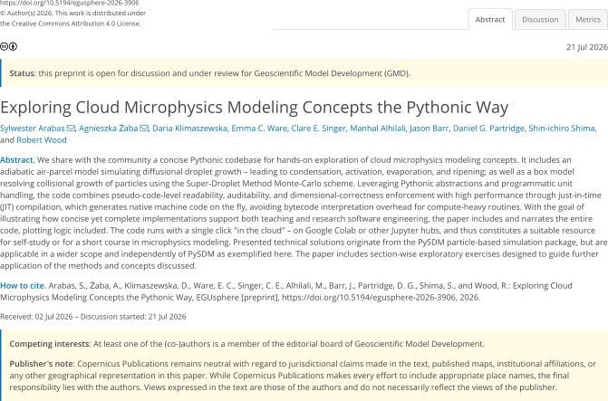
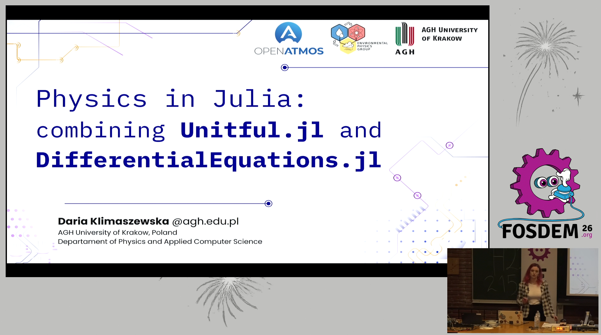

```{python}
#| echo: false
from IPython import get_ipython

ip = get_ipython()
if ip is not None:
    ip.InteractiveTB.mode = 'Minimal'

# AGH colours + colour-blind-safe linestyles + font sizes
import matplotlib
from cycler import cycler

%config InlineBackend.figure_formats = ['svg']
matplotlib.rcParams.update(
    {
        "axes.prop_cycle": cycler(color=("#A71930", "#00693C", "#1E1E1E"))
        + cycler(linestyle=("-", "--", ":")),
        "lines.linewidth": 1.5,
        "lines.markersize": 5,
        "axes.grid": True,
        "font.size": 13,
        "axes.labelsize": 13,
        "axes.titlesize": 15,
        "legend.fontsize": 13,
        "xtick.labelsize": 13,
        "ytick.labelsize": 13,
        "figure.figsize": (10, 2.1),
        "legend.handlelength": 1.0,
        "figure.constrained_layout.use": True,
    }
)

```

[//]: # (![]&#40;https://www.geoscientific-model-development.net/graphic_egu_claim_logo_blue.png&#41;{width="1em"})

##  an experiment: paper on how to code 

{fig-align="center"}

## scope of the paper and of this talk

:::: {.columns}

::: {.column width="75%"}
1: aerosol size spectrum sampling    
2: **unit-aware coding and plotting**    
3: parcel model governing equations    
4: JIT compilation using Numba    
5: parcel ODE system definition    
6: **test-time dimensional analysis using Pint**    
7: initial condition at equilibrium    
8: ODE integration and result analysis    
9: Super-Droplet Method algorithm    
10: SDM against analytic solution    
::: 

::: {.column width="25%"}
TODO: Python+Pint logos?
:::

::::

::: {.notes}
Must have: physical units ()
W C++, w Julii, ..
W Python nie jest to oczywiste jak to zrobić: wyzwaniem jest połączenie z numpy,
  optymalizacja obliczeń (without overhead...)
:::

## a useful physical example: ideal gas
<br>

:::: {.columns}

::: {.column width="40%"}
<span style="font-size:400%">🎈</span>
<span style="font-size:200%">🎈</span>
<span style="font-size:100%">🎈</span>
<span style="font-size:50%">🎈</span>
:::

::: {.column width="60%"}

<h4>equation of state linking density $\rho$, pressure&nbsp;$p$ and temperature $T$</h4>
$$\rho = (p M) / (T R)$$

$M$: molar mass
$R$: universal gas constant
:::

::::

## Issue \#1: units in code (example: ideal gas density)

$$\rho = (p M) / (T R)$$

```{python}
#| code-line-numbers: "1|1-2|1-8|1-11"

import numpy, matplotlib.pyplot as plt
import mendeleev, scipy.constants as ct

p = 1000                                     # pressure [mbar]
T = numpy.linspace(250, 300)                 # temperature [K]
R = ct.R                                     # gas constant [J/K/mol]
M = (0.78 * 2 * mendeleev.N.atomic_weight +  # molar mass [g/mol]
     0.22 * 2 * mendeleev.O.atomic_weight)

plt.plot(T, (p * M) / (R * T))
plt.gca().set(ylabel="density", xlabel="temperature")
```


::: {.fragment}

- What is the unit of the output? 
- After changing the value of one of the variables - did you change the comment? 
- Reproducible code; easy to read one year later

How to fix it? 

:::

## physical units in code with Pint

<br> <br>

:::: {.columns}

::: {.column width="70%"}
- <b><https://pint.readthedocs.io></b>

- `%pip install pint`

- `import pint`

:::
::: {.column width="30%"}

:::
::::


## physical units with Pint (example: ideal gas density)

$$\rho = (p M) / (T R)$$

```{python}
#| code-line-numbers: "1-2|1-4|1-5|1-6|1-8|-"

import pint
(SI := pint.UnitRegistry()).setup_matplotlib()

pressure = 1000 * SI.mbar
temperatures = numpy.linspace(250, 300) * SI.K
gas_const = ct.R * SI.J / SI.K / SI.mol
molar_mass = (0.78 * 2 * mendeleev.N.atomic_weight +
              0.22 * 2 * mendeleev.O.atomic_weight) * SI.g / SI.mol

plt.plot(temperatures, (pressure * molar_mass) / (gas_const * temperatures))
```
---

### Can we ...

::: {.fragment}

- ... change the units on the plot?
:::

::: {.fragment}
```{python}
plt.gca().xaxis.set_units(SI.degC)
plt.gca().yaxis.set_units(SI.kg / SI.m**3)
plt.plot(temperatures, (pressure * molar_mass) / (gas_const * temperatures))

axs = plt.gca()
axs.set_xlabel(f"temperature [{axs.xaxis.units:~P}]")
axs.set_ylabel(f"density [{axs.yaxis.units:~P}]");
```

:::

::: {.fragment}

- ... change the units to the wrong ones?
:::

::: {.fragment}

```{python}
#| error: true

plt.gca().yaxis.set_units(SI.J)
plt.plot(pressure)
```
:::

---

### Can we ...

::: {.fragment}

- ... put different quantities on same axis?
:::

::: {.fragment}

```{python}
#| error: true
try:
    plt.plot(temperatures)
    plt.plot(temperatures ** 2)
except Exception as e:
    plt.close()
    print(e.__cause__)
```
:::

::: {.fragment}

- ... add Kelvins to Pascals?
:::


::: {.fragment}

```{python}
#| error: true

temperatures + molar_mass
```

:::

<br>

::: {.fragment}

- Tools for unit testing:

```{python}
((pressure * molar_mass) / (gas_const * temperatures)).check("[density]")
```

:::

---

### Pint: key takeaways

::: {.incremental}
- ⚖️ performs dimensional analysis (unit testing!)
- ⚙️ automates plot axis labelling (and consistency checks)
- 💱 handles SI prefixes and unit conversions
- 🩺 helps in debugging (`print(x)` prints a value with unit)
:::


::: {.fragment}
### Pint: key limitations
:::

::: {.fragment}

- ⏱️ <s>incurs performance overhead</s>
:::
::: {.fragment}

- 🔗 <s>no out-of-the-box interoperability with SciPy/Numba</s>
:::


## Issue \#2: units with `scipy` and `numba`

Problem with using units with `scipy`/ `numpy` packages:
```{python}
#| error: true
#| code-line-numbers: "1|1-3|-"

from scipy.optimize import root_scalar

f = lambda T, a, b: a / T + b

root_scalar(
    f=f,
    x0=1 * SI.K,
    args=(2 * SI.K**2, -3 * SI.K)
)
```

<br>

::: {.fragment}

Problem with using just-in-time compilation (`numba`)
```{python}
#| code-line-numbers: "1|1-5|"
import numba

@numba.jit
def f(a, b, T):
  return a / T + b

print(f"{f(2, -3, 270):.3g}")
```
:::


::: {.fragment}
```{python}
#| error: true

f(2 * SI.K**2, -3 * SI.K, 270 * SI.K)
```

::: 

::: {.fragment}

<br>
### How to solve it?
:::

::: {.fragment}
`see Section 4. in our paper!`

:::

## no excuse for coding without units, let's&nbsp;teach&nbsp;it!

:::: {.columns style="font-size: 0.5em;"}

::: {.column width="33%"}
"hacking aerosol-cloud μ-physics modeling concepts in Python" 

**University of Washington**, Jan 2026, Seattle (Erasmus+ for teachers)


::: 

::: {.column width="33%"}
FOSDEM 2026

**Université libre de Bruxelles**, Feb 2026


::: 

::: {.column width="33%"}
"Gluing SciPy, Numba, and Pint to Bridge High Performance with Maintainability" 

EuroScipy 2026 (Jul, **Wydział Informatyki AGH**)


::: 

+ **AGH courses**: PP, PI, MUP, MPS, RSE, ...

::::

## looking for a venue to publish it: GMD 

+ idea: code-in-paper
+ paper serving as ready-to-use workshop materials
+ GMD requirements: all figures reproducible by editors, reviewers, readers
+ our answer: everything in a single Jupyter notebook (i.e. single click generation of the paper pdf!)

## { style="width:100px" } Quarto

[Extensions -- quarto journals](https://quarto.org/docs/extensions/listing-journals.html) include:

- American Geophysical Union (AGU)
- Elsevier
- Springer Nature Submissions
- Association for Advancement of Artificial Intelligence (AAAI)
- ...

```{bash}
quarto use template quarto-journals/agu
quarto render paper.qmd --to pdf
quarto render paper.ipynb --to pdf
```

--- 

- reproducible!!! 
- for everyone
- journal templates as alternative to LaTeX templates
- executable code for reproducible results (no copy-paste )
- tests inside
- perfect for BEng/MSc/PhD theses!

## Habemus Python 

:::: {.columns}

::: {.column width="40%"}

:::
::: {.column width="60%"}

:::

::::

## Quarto Actions

TODO

## Summary and ideas

+ encourage everyone to support their students in using Pint, Quarto, Habemus Python
+ AGH Summer/Winter school/workshop on cloud microphysics modelling using the GMD paper?
+ acknowledgements: Kamil, co-authors, ...
